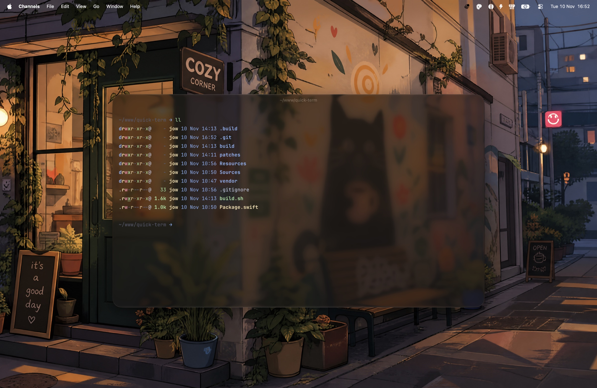

# Quick Term

A quick terminal for macOS that appears on a Liquid Glass card in the middle of the screen. Hold the left and right Command keys together to summon it, and again to dismiss it.

It is built on [libghostty](https://github.com/ghostty-org/ghostty), so it renders like Ghostty and reads your existing Ghostty config.



## Features

- **⌘⌘ to toggle.** Left and right Command together. No Accessibility or Input Monitoring permission is needed.
- **Your Ghostty config.** Fonts, themes and keybinds come from `~/.config/ghostty/config`.
- **Splits.** `new_split` keybinds work (for example ⌘D right, ⌘⇧D down), as do Ghostty's split-navigation bindings. A new split starts in the directory of the one it came from.
- **Sessions persist.** Dismissing the card keeps the shells running. `exit` or closing the last split ends the session; the next summon starts a fresh one.
- **Stays out of the way.** It takes keyboard focus without activating, so the app you were in gets focus back. Clicking elsewhere dismisses it.

## Requirements

- macOS 26 or later
- Xcode, including the Metal Toolchain (`xcodebuild -downloadComponent MetalToolchain`)
- Zig 0.17 (the version Ghostty currently builds with)

## Build

```sh
./build.sh            # builds build/Quick Term.app
./build.sh --install  # also copies it to /Applications and launches it
```

The first build clones Ghostty into `vendor/ghostty`, applies the patches in `patches/`, and compiles libghostty, which takes a few minutes. Later builds reuse it. Delete `vendor/ghostty` to pick up a newer Ghostty.

## Configuration

Quick Term loads your normal Ghostty config and then applies a few defaults of its own so the glass shows through: a transparent background and tighter padding.

To override anything for Quick Term only, put Ghostty options in `~/.config/quick-term/config`. It is loaded last and wins.

The card's size is set with `defaults`:

```sh
defaults write local.quick-term width 1200
defaults write local.quick-term height 700
```

Right-click the title strip at the top of the card for Reload Config, Open Ghostty Config, Launch at Login and Quit.

## Limitations

- Splits are always even halves; they can't be resized.
- No tabs.
- The app is ad-hoc signed by `build.sh`, not notarized.
